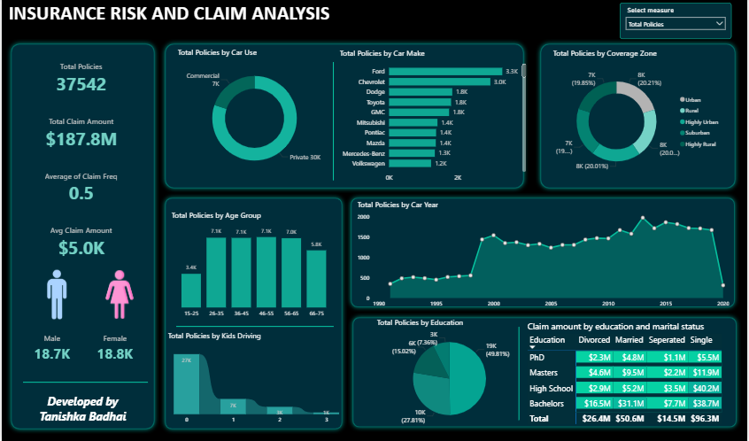

# Insurance Risk & Claim Analysis — Power BI Dashboard

An interactive Power BI dashboard that gives a single view of an insurance company's policyholders, vehicles and claims: who the customers are, what they drive, where they live, and how much they claim.



---

## Business Problem

An insurance company's policy and claims data is scattered across sources, so stakeholders can't easily track performance or spot trends. The goal is one centralized dashboard that answers:

- How large is the policyholder base?
- How much are claims costing, and how often are they filed?
- Which customer segments, vehicles and regions carry the most risk?

## Dataset

`insurance_policies_data.xlsx` — **37,542 policies × 16 columns**, no missing values.

| Group | Columns |
|---|---|
| Customer | ID, BirthDate, Gender, Marital Status, Education, Parent, Household Income, Kids Driving |
| Vehicle | Car Color, Car Make, Car Model, Car Year, Car Use |
| Location | Coverage Zone (Urban, Highly Urban, Suburban, Rural, Highly Rural) |
| Claims | Claim Amount, Claim Freq |

## KPIs

| KPI | Value |
|---|---|
| Total Policies | 37,542 |
| Total Claim Amount | $187.8M |
| Average Claim Frequency | 0.5 |
| Average Claim Amount | $5.0K |
| Policies by Gender | Male 18.7K / Female 18.8K |

## Visuals

All visuals respond to a **measure selector** that switches between *Total Policies* and *Total Claim Amount*.

| Visual | Chart type | Purpose |
|---|---|---|
| Car Use | Donut | Private vs commercial policies |
| Car Make | Bar | Brands with the most policies/claims |
| Coverage Zone | Donut | Regional risk distribution |
| Age Group | Column | Which age brackets hold the most policies |
| Car Year | Area | Vehicle age vs policies/claims |
| Kids Driving | Ribbon | Effect of young drivers in the household |
| Education | Pie | Education level vs policy adoption |
| Education × Marital Status | Matrix heat grid | Combined effect on claim amount |

## Key Observations

- **Private use dominates:** about 30K of 37.5K policies (80%) are private; about 7.5K are commercial.
- **Top makes by policy count:** Ford (3.3K), Chevrolet (3.0K), then Dodge, Toyota and GMC (~1.8K each).
- **Zones are evenly split:** each of the five coverage zones holds roughly 20% of policies.
- **Age:** policies peak between ages 26 and 65 (~7K per bracket); the 15–25 group is smallest.
- **Education:** Bachelors holders make up about half of all policyholders (49.8%).
- **Kids driving:** most households (about 27K) have no kids driving.

## DAX / Modeling Notes

- Age calculated from `BirthDate`, then bucketed into groups (15–25, 26–35, 36–45, 46–55, 56–65, 66–75).
- Measures: Total Policies (`COUNTROWS`), Total Claim Amount (`SUM`), Avg Claim Freq (`AVERAGE`), Avg Claim Amount (Total Claim Amount ÷ Total Policies).
- A disconnected table plus a `SWITCH` measure drives the dynamic *Select measure* slicer.

<!-- Edit the DAX bullets above to match exactly what you wrote in your .pbix -->

## Tools

Power BI Desktop · DAX · Power Query · Excel

## Repository Structure

```
├── README.md
├── Insurance_Risk_Claim_Analysis.pbix
├── insurance_policies_data.xlsx
└── dashboard.png
```

## How to Open

1. Download `Insurance_Risk_Claim_Analysis.pbix`.
2. Open it in **Power BI Desktop** (free download for Windows).
3. If prompted, point the data source to your local copy of `insurance_policies_data.xlsx` (Home → Transform data → Data source settings).

## What I Learned

- Cleaning and shaping data in Power Query
- Writing DAX measures and calculated columns
- Building a dynamic measure switcher
- Choosing the right chart for each question
- Designing a KPI-first dashboard layout

## Acknowledgements

Built with guidance from the [Data Tutorials](https://www.youtube.com/@datatutorials1) Power BI tutorial on YouTube.

## Author

**Tanishka Badhai ** — Final year Computer Engineering student
[LinkedIn](https://www.linkedin.com/in/tanishka-b-37462b323/) 
